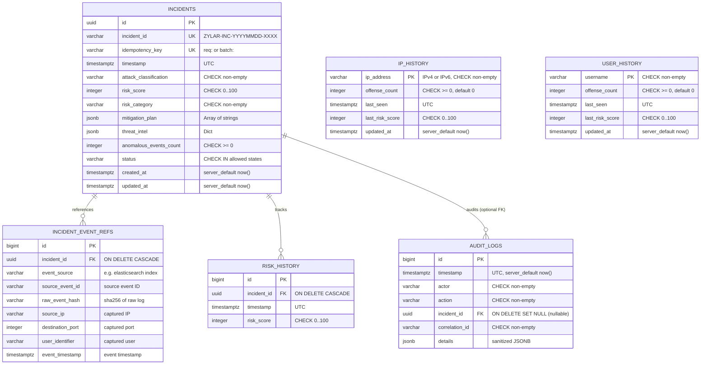

# Zylar Phase 4.1: Database Architecture and Persistence Design (Revised)

**Version:** 2.0  
**Date:** 27 October 2026  
**Status:** Approved Architecture & Implementation Specification  
**Scope:** PostgreSQL Transactional System of Record, SQLAlchemy 2.x Models, Repository Contracts, Alembic Foundation, and SQLite Retirement Plan

---

## 1. Executive Summary & Architectural Scope

Phase 4 establishes **PostgreSQL** as Zylar's authoritative, transactional system of record for SOC application state, incident lifecycles, entity history, and audit trails.

### Separation of Concerns: PostgreSQL vs. Elasticsearch

```
+------------------------------------------------------------------------------------+
|                                    Zylar SOC                                       |
+------------------------------------------------------------------------------------+
              |                                                   |
              v                                                   v
   [ Elasticsearch Cluster ]                           [ PostgreSQL Database ]
   • Searchable security log events                     • Transactional system of record
   • Time-series analytics & fast aggregation           • Incident lifecycles & state transitions
   • Raw log payload retention                          • Event reference mappings (IDs & hashes)
   • Read-only source of truth for raw logs             • Offender recurrence & risk history
                                                       • Audit logs & user authorization state
```

- **Elasticsearch**: Retains indexed security log events for fast full-text filtering and anomaly scoring. Raw log bodies are never duplicated wholesale into PostgreSQL.
- **PostgreSQL**: Stores canonical incident entities, foreign-keyed event reference metadata, historical offender tracking, risk telemetry, and audit logs with ACID transactional guarantees.
- **Zero Silent Fallback**: Database connection or transaction failures fail loudly and return structured error codes. The application never silently routes failed writes to SQLite or in-memory storage.

---

## 2. Analysis of Existing SQLite Persistence Layer

The existing SQLite implementation ([`memory/sqlite_manager.py`](../../memory/sqlite_manager.py)) exhibits critical architectural limitations that Phase 4 remediates:

| Feature / Pattern | SQLite Implementation (`memory/sqlite_manager.py`) | Architectural Risk / Limitation | PostgreSQL Target Design |
| --- | --- | --- | --- |
| **Timestamps** | String concatenation (`datetime.utcnow().isoformat() + "Z"`) | Naive strings; potential drift, no timezone indexing or comparison | `TIMESTAMP WITH TIME ZONE` (`DateTime(timezone=True)`) |
| **Complex Payloads** | Unindexed `TEXT` fields storing serialized JSON strings | No schema enforcement or queryability for mitigation steps or threat intel | `JSONB` columns with Pydantic domain validation |
| **Idempotency** | Silent ignore on primary key collision (`except sqlite3.IntegrityError: pass`) | Swallows collisions without verifying payload equality; random IDs allow duplicate incidents for identical log batches | Explicit idempotency keys (`req:<id>` or `batch:<hash>`) with database-enforced `UNIQUE` constraint and domain conflict detection |
| **Transaction Boundary** | `update_entity_history` is called early inside `calculate_risk_node` | Entity history is mutated before incident creation. If downstream nodes fail, history counts are permanently corrupted | Atomic Unit of Work: incident creation, risk history, entity history update, and audit log commit in a **single ACID transaction** |
| **Foreign Keys** | Unconstrained `incident_id TEXT` in `risk_history` | Orphaned records on incident deletion or rollback | Foreign key referencing `incidents.id` with `ON DELETE CASCADE` |
| **Concurrency** | File-level lock (`zylar_memory.db`) | Contention, database locks under concurrent API requests | Row-level locking (`SELECT ... FOR UPDATE`), connection pooling, MVCC |

---

## 3. Relational Schema Design & Constraints

### Entity-Relationship Diagram



### Table Definitions & Constraints

1. **`incidents`**:
   - `id`: `UUID` primary key (default: `gen_random_uuid()`).
   - `incident_id`: `VARCHAR(64)` unique, non-null (human-readable, e.g. `ZYLAR-INC-20261027-A1B2`).
   - `idempotency_key`: `VARCHAR(128)` unique, non-null (scoped idempotency key).
   - `timestamp`: `TIMESTAMP WITH TIME ZONE` not null, indexed.
   - `attack_classification`: `VARCHAR(64)` not null.
   - `risk_score`: `INTEGER` not null.
   - `risk_category`: `VARCHAR(32)` not null.
   - `mitigation_plan`: `JSONB` not null default `'[]'::jsonb`.
   - `threat_intel`: `JSONB` not null default `'{}'::jsonb`.
   - `anomalous_events_count`: `INTEGER` not null default 0.
   - `status`: `VARCHAR(32)` not null default `'NEW'`.
   - `created_at`: `TIMESTAMP WITH TIME ZONE` not null, server-default `func.now()`.
   - `updated_at`: `TIMESTAMP WITH TIME ZONE` not null, server-default `func.now()`.
   - **Constraints**:
     - `CHECK (risk_score >= 0 AND risk_score <= 100)`
     - `CHECK (anomalous_events_count >= 0)`
     - `CHECK (status IN ('NEW', 'TRIAGED', 'INVESTIGATING', 'RESOLVED', 'CLOSED', 'FALSE_POSITIVE'))`
     - `CHECK (length(trim(incident_id)) > 0)`
     - `CHECK (length(trim(attack_classification)) > 0)`
     - `CHECK (length(trim(risk_category)) > 0)`

2. **`incident_event_refs`**:
   - Stores references and correlation attributes of events contributing to an incident without duplicating raw log strings.
   - `id`: `BIGINT` generated always as identity primary key.
   - `incident_id`: `UUID` foreign key referencing `incidents(id)` on delete cascade.
   - `event_source`: `VARCHAR(64)` not null (e.g. `zylar-security-events`).
   - `source_event_id`: `VARCHAR(128)` not null.
   - `raw_event_hash`: `VARCHAR(64)` not null.
   - `source_ip`: `VARCHAR(45)` nullable.
   - `destination_port`: `INTEGER` nullable.
   - `user_identifier`: `VARCHAR(128)` nullable.
   - `event_timestamp`: `TIMESTAMP WITH TIME ZONE` not null.
   - **Constraints & Indexes**:
     - `UNIQUE (incident_id, event_source, source_event_id)`
     - Index on `(event_source, source_event_id)` for reverse lookup.

3. **`ip_history`**:
   - `ip_address`: `VARCHAR(45)` primary key (supports IPv4 and IPv6).
   - `offense_count`: `INTEGER` not null default 0.
   - `last_seen`: `TIMESTAMP WITH TIME ZONE` not null.
   - `last_risk_score`: `INTEGER` not null.
   - `updated_at`: `TIMESTAMP WITH TIME ZONE` not null, server-default `func.now()`.
   - **Constraints**:
     - `CHECK (offense_count >= 0)`
     - `CHECK (last_risk_score >= 0 AND last_risk_score <= 100)`
     - `CHECK (length(trim(ip_address)) > 0)`

4. **`user_history`**:
   - `username`: `VARCHAR(128)` primary key.
   - `offense_count`: `INTEGER` not null default 0.
   - `last_seen`: `TIMESTAMP WITH TIME ZONE` not null.
   - `last_risk_score`: `INTEGER` not null.
   - `updated_at`: `TIMESTAMP WITH TIME ZONE` not null, server-default `func.now()`.
   - **Constraints**:
     - `CHECK (offense_count >= 0)`
     - `CHECK (last_risk_score >= 0 AND last_risk_score <= 100)`
     - `CHECK (length(trim(username)) > 0)`

5. **`risk_history`**:
   - `id`: `BIGINT` generated always as identity primary key.
   - `incident_id`: `UUID` foreign key referencing `incidents(id)` on delete cascade.
   - `timestamp`: `TIMESTAMP WITH TIME ZONE` not null.
   - `risk_score`: `INTEGER` not null.
   - **Constraints & Indexes**:
     - `CHECK (risk_score >= 0 AND risk_score <= 100)`
     - Index on `(incident_id, timestamp)`

6. **`audit_logs`**:
   - `id`: `BIGINT` generated always as identity primary key.
   - `timestamp`: `TIMESTAMP WITH TIME ZONE` not null, server-default `func.now()`.
   - `actor`: `VARCHAR(128)` not null.
   - `action`: `VARCHAR(64)` not null.
   - `incident_id`: `UUID` nullable foreign key referencing `incidents(id)` on delete set null.
   - `correlation_id`: `VARCHAR(64)` not null.
   - `details`: `JSONB` not null default `'{}'::jsonb`.
   - **Constraints & Indexes**:
     - `CHECK (length(trim(actor)) > 0)`
     - `CHECK (length(trim(action)) > 0)`
     - `CHECK (length(trim(correlation_id)) > 0)`
     - Index on `timestamp`
     - Index on `correlation_id`

---

## 4. Idempotency Specification & Conflict Resolution

### Idempotency Scope Definition

1. **API Workflow Invocations (`POST /api/workflow/run`)**:
   - If the caller supplies an `Idempotency-Key` or `request_id` in headers/payload, the key is scoped:
     `idempotency_key = f"req:{request_id}"`
   - If omitted, falls back to batch event identity:
     `idempotency_key = f"batch:{hashlib.sha256(canonical_identity).hexdigest()}"`

2. **Autonomous Polling / Scheduled Ingestion**:
   - The key is derived deterministically from the detection source index and the sorted set of constituent event IDs:
     `canonical_identity = f"{event_source}:" + ",".join(sorted(event_ids))`
     `idempotency_key = f"batch:{hashlib.sha256(canonical_identity.encode('utf-8')).hexdigest()}"`

### Duplicate Conflict Semantics

When attempting to persist an incident:
- **Case 1: True Duplicate Retry**:
  The incoming payload's constituent event IDs and classification match the existing incident with that `idempotency_key`.
  - Action: Return the existing incident with `created = False`.
  - Invariant: **DO NOT** increment `ip_history` or `user_history` offense counts. **DO NOT** insert duplicate `risk_history`.
- **Case 2: Payload Conflict Under Reused Key**:
  The incoming payload has different events, classification, or data under an existing `idempotency_key`.
  - Action: Raise `IdempotencyConflictError(f"Idempotency key '{key}' already exists with different payload.")` resulting in an HTTP 409 Conflict.
- **Concurrency Protection**:
  The database enforces `UNIQUE (idempotency_key)`. Concurrent inserts with the same key will hit a database unique violation; the repository catches this, rolls back to the savepoint, and fetches the existing record to verify equality.

---

## 5. Audit Logging Specification & Secret Redaction

### Audited Event Operations

| Event Action | Triggering Context | Actor Format | Details Content |
| --- | --- | --- | --- |
| `INCIDENT_CREATED` | New incident persisted via autonomous batch or API | `system:autonomous` or `user:<username>` | Classification, risk score, event count, idempotency key |
| `INCIDENT_STATUS_CHANGED` | Analyst updates status (e.g. `NEW` -> `TRIAGED`) | `user:<username>` | Previous status, new status, rationale |
| `RECURRENCE_PENALTY_EVALUATED` | High recurrence penalty (>50) applied to an incident | `system:risk_engine` | Evaluated IPs, evaluated users, recurrence score |
| `ADMIN_SECURITY_MODIFICATION` | Admin modifies users or system configurations | `admin:<username>` | Target user, modified attributes |

### Secret Redaction Policy

Before serializing into `audit_logs.details`:
- Filter through `sanitize_audit_details(dict)`.
- Strip or mask: `password`, `token`, `secret`, `authorization`, `database_url`, `signing_key`.
- Never store raw credentials or connection strings in audit records.

---

## 6. SQLAlchemy 2.x Declarative Models

Located in `src/zylar/persistence/models.py`:

```python
from __future__ import annotations

import uuid
from datetime import datetime
from typing import Any

from sqlalchemy import (
    BigInteger,
    CheckConstraint,
    DateTime,
    ForeignKey,
    Index,
    Integer,
    String,
    UniqueConstraint,
    func,
    text,
)
from sqlalchemy.dialects.postgresql import JSONB, UUID
from sqlalchemy.orm import DeclarativeBase, Mapped, mapped_column, relationship


class Base(DeclarativeBase):
    """Base class for all Zylar SQLAlchemy 2.0 models."""
    pass


class IncidentModel(Base):
    __tablename__ = "incidents"

    id: Mapped[uuid.UUID] = mapped_column(UUID(as_uuid=True), primary_key=True, default=uuid.uuid4)
    incident_id: Mapped[str] = mapped_column(String(64), unique=True, nullable=False)
    idempotency_key: Mapped[str] = mapped_column(String(128), unique=True, nullable=False)
    timestamp: Mapped[datetime] = mapped_column(DateTime(timezone=True), nullable=False, index=True)
    attack_classification: Mapped[str] = mapped_column(String(64), nullable=False)
    risk_score: Mapped[int] = mapped_column(Integer, nullable=False)
    risk_category: Mapped[str] = mapped_column(String(32), nullable=False)
    mitigation_plan: Mapped[list[str]] = mapped_column(JSONB, nullable=False, server_default=text("'[]'::jsonb"))
    threat_intel: Mapped[dict[str, Any]] = mapped_column(JSONB, nullable=False, server_default=text("'{}'::jsonb"))
    anomalous_events_count: Mapped[int] = mapped_column(Integer, nullable=False, default=0)
    status: Mapped[str] = mapped_column(String(32), nullable=False, default="NEW", index=True)
    created_at: Mapped[datetime] = mapped_column(
        DateTime(timezone=True), nullable=False, server_default=func.now()
    )
    updated_at: Mapped[datetime] = mapped_column(
        DateTime(timezone=True), nullable=False, server_default=func.now(), onupdate=func.now()
    )

    event_refs: Mapped[list[IncidentEventRefModel]] = relationship(
        "IncidentEventRefModel", back_populates="incident", cascade="all, delete-orphan"
    )
    risk_records: Mapped[list[RiskHistoryModel]] = relationship(
        "RiskHistoryModel", back_populates="incident", cascade="all, delete-orphan"
    )
    audit_records: Mapped[list[AuditLogModel]] = relationship(
        "AuditLogModel", back_populates="incident"
    )

    __table_args__ = (
        CheckConstraint("risk_score >= 0 AND risk_score <= 100", name="chk_incidents_risk_score_range"),
        CheckConstraint("anomalous_events_count >= 0", name="chk_incidents_anomalous_events_nonneg"),
        CheckConstraint(
            "status IN ('NEW', 'TRIAGED', 'INVESTIGATING', 'RESOLVED', 'CLOSED', 'FALSE_POSITIVE')",
            name="chk_incidents_valid_status",
        ),
        CheckConstraint("length(trim(incident_id)) > 0", name="chk_incidents_id_not_blank"),
        CheckConstraint("length(trim(attack_classification)) > 0", name="chk_incidents_classification_not_blank"),
        CheckConstraint("length(trim(risk_category)) > 0", name="chk_incidents_category_not_blank"),
        Index("ix_incidents_created_at", "created_at"),
        Index("ix_incidents_status_risk", "status", "risk_score"),
    )


class IncidentEventRefModel(Base):
    __tablename__ = "incident_event_refs"

    id: Mapped[int] = mapped_column(BigInteger, primary_key=True, autoincrement=True)
    incident_id: Mapped[uuid.UUID] = mapped_column(
        UUID(as_uuid=True), ForeignKey("incidents.id", ondelete="CASCADE"), nullable=False, index=True
    )
    event_source: Mapped[str] = mapped_column(String(64), nullable=False)
    source_event_id: Mapped[str] = mapped_column(String(128), nullable=False)
    raw_event_hash: Mapped[str] = mapped_column(String(64), nullable=False)
    source_ip: Mapped[str | None] = mapped_column(String(45), nullable=True)
    destination_port: Mapped[int | None] = mapped_column(Integer, nullable=True)
    user_identifier: Mapped[str | None] = mapped_column(String(128), nullable=True)
    event_timestamp: Mapped[datetime] = mapped_column(DateTime(timezone=True), nullable=False)

    incident: Mapped[IncidentModel] = relationship("IncidentModel", back_populates="event_refs")

    __table_args__ = (
        UniqueConstraint("incident_id", "event_source", "source_event_id", name="uq_incident_source_event"),
        Index("ix_event_ref_lookup", "event_source", "source_event_id"),
    )


class IPHistoryModel(Base):
    __tablename__ = "ip_history"

    ip_address: Mapped[str] = mapped_column(String(45), primary_key=True)
    offense_count: Mapped[int] = mapped_column(Integer, nullable=False, default=0)
    last_seen: Mapped[datetime] = mapped_column(DateTime(timezone=True), nullable=False)
    last_risk_score: Mapped[int] = mapped_column(Integer, nullable=False)
    updated_at: Mapped[datetime] = mapped_column(
        DateTime(timezone=True), nullable=False, server_default=func.now(), onupdate=func.now()
    )

    __table_args__ = (
        CheckConstraint("offense_count >= 0", name="chk_ip_history_offense_nonneg"),
        CheckConstraint("last_risk_score >= 0 AND last_risk_score <= 100", name="chk_ip_history_last_risk_range"),
        CheckConstraint("length(trim(ip_address)) > 0", name="chk_ip_history_address_not_blank"),
    )


class UserHistoryModel(Base):
    __tablename__ = "user_history"

    username: Mapped[str] = mapped_column(String(128), primary_key=True)
    offense_count: Mapped[int] = mapped_column(Integer, nullable=False, default=0)
    last_seen: Mapped[datetime] = mapped_column(DateTime(timezone=True), nullable=False)
    last_risk_score: Mapped[int] = mapped_column(Integer, nullable=False)
    updated_at: Mapped[datetime] = mapped_column(
        DateTime(timezone=True), nullable=False, server_default=func.now(), onupdate=func.now()
    )

    __table_args__ = (
        CheckConstraint("offense_count >= 0", name="chk_user_history_offense_nonneg"),
        CheckConstraint("last_risk_score >= 0 AND last_risk_score <= 100", name="chk_user_history_last_risk_range"),
        CheckConstraint("length(trim(username)) > 0", name="chk_user_history_username_not_blank"),
    )


class RiskHistoryModel(Base):
    __tablename__ = "risk_history"

    id: Mapped[int] = mapped_column(BigInteger, primary_key=True, autoincrement=True)
    incident_id: Mapped[uuid.UUID] = mapped_column(
        UUID(as_uuid=True), ForeignKey("incidents.id", ondelete="CASCADE"), nullable=False, index=True
    )
    timestamp: Mapped[datetime] = mapped_column(DateTime(timezone=True), nullable=False, index=True)
    risk_score: Mapped[int] = mapped_column(Integer, nullable=False)

    incident: Mapped[IncidentModel] = relationship("IncidentModel", back_populates="risk_records")

    __table_args__ = (
        CheckConstraint("risk_score >= 0 AND risk_score <= 100", name="chk_risk_history_score_range"),
        Index("ix_risk_history_incident_time", "incident_id", "timestamp"),
    )


class AuditLogModel(Base):
    __tablename__ = "audit_logs"

    id: Mapped[int] = mapped_column(BigInteger, primary_key=True, autoincrement=True)
    timestamp: Mapped[datetime] = mapped_column(
        DateTime(timezone=True), nullable=False, server_default=func.now(), index=True
    )
    actor: Mapped[str] = mapped_column(String(128), nullable=False)
    action: Mapped[str] = mapped_column(String(64), nullable=False)
    incident_id: Mapped[uuid.UUID | None] = mapped_column(
        UUID(as_uuid=True), ForeignKey("incidents.id", ondelete="SET NULL"), nullable=True, index=True
    )
    correlation_id: Mapped[str] = mapped_column(String(64), nullable=False, index=True)
    details: Mapped[dict[str, Any]] = mapped_column(JSONB, nullable=False, server_default=text("'{}'::jsonb"))

    incident: Mapped[IncidentModel | None] = relationship("IncidentModel", back_populates="audit_records")

    __table_args__ = (
        CheckConstraint("length(trim(actor)) > 0", name="chk_audit_logs_actor_not_blank"),
        CheckConstraint("length(trim(action)) > 0", name="chk_audit_logs_action_not_blank"),
        CheckConstraint("length(trim(correlation_id)) > 0", name="chk_audit_logs_correlation_not_blank"),
    )
```

---

## 7. Repository Contracts & Unit-of-Work Architecture

### Typed Data Transfer Objects

```python
from __future__ import annotations

from dataclasses import dataclass
from datetime import datetime
from typing import Any

from pydantic import BaseModel, ConfigDict, Field

from zylar.persistence.models import IncidentModel


class EventRefData(BaseModel):
    model_config = ConfigDict(extra="forbid")

    event_source: str
    source_event_id: str
    raw_event_hash: str
    source_ip: str | None = None
    destination_port: int | None = None
    user_identifier: str | None = None
    event_timestamp: datetime


class IncidentCreate(BaseModel):
    model_config = ConfigDict(extra="forbid")

    incident_id: str
    idempotency_key: str
    timestamp: datetime
    attack_classification: str
    risk_score: int = Field(..., ge=0, le=100)
    risk_category: str
    mitigation_plan: list[str] = Field(default_factory=list)
    threat_intel: dict[str, Any] = Field(default_factory=dict)
    anomalous_events_count: int = Field(default=0, ge=0)
    contributing_events: list[EventRefData] = Field(default_factory=list)
    contributing_ips: list[str] = Field(default_factory=list)
    contributing_users: list[str] = Field(default_factory=list)
    correlation_id: str
    actor: str = "system:autonomous"


@dataclass(frozen=True)
class PersistIncidentResult:
    incident: IncidentModel
    created: bool
    existing: bool = False
```

### Unit of Work Pattern

```python
from __future__ import annotations

from typing import Self
from sqlalchemy.orm import Session, sessionmaker

class UnitOfWork:
    def __init__(self, session_factory: sessionmaker[Session]):
        self._session_factory = session_factory
        self.session: Session | None = None

    def __enter__(self) -> Self:
        self.session = self._session_factory()
        self.session.begin()
        return self

    def __exit__(self, exc_type, exc_val, exc_tb):
        if self.session is not None:
            if exc_type is not None:
                self.session.rollback()
            else:
                self.session.commit()
            self.session.close()

    def persist_incident_lifecycle(self, data: IncidentCreate) -> PersistIncidentResult:
        """Executes incident creation, event refs, risk history, entity history, and audit log atomically."""
        ...
```

---

## 8. Dependency Specification & Diff

### Required Packages in `pyproject.toml`

```toml
[project]
dependencies = [
  # Core dependencies...
  "alembic==1.15.1",
  "psycopg[binary]==3.2.5",
  "sqlalchemy==2.0.40",
]
```

- **`sqlalchemy==2.0.40`**: Strict 2.x declarative, mapped attributes, typed query API.
- **`psycopg[binary]==3.2.5`**: Modern PostgreSQL driver supporting Python 3.12, binary wheels, and connection pooling.
- **`alembic==1.15.1`**: Migration management, versioned schema generation, and deterministic upgrade tracking.

---

## 9. SQLite Call Site Inventory & Revised Workflow Boundary

| Current File & Line | Current SQLite Call Site | Target PostgreSQL Architecture |
| --- | --- | --- |
| `agents/risk_agent.py:71` | `update_entity_history(ips, users, final_score)` | **REMOVED from risk scoring node.** `calculate_risk_node` only calls `get_recurrence_factor(...)` (read-only query). Returns `contributing_ips` and `contributing_users` in state. |
| `agents/report_agent.py:56` | `log_incident(report_content)` | **Replaced with UnitOfWork atomic transaction.** Persists incident, event refs, risk history, offender updates, and audit record in a single transaction. |
| `api/main.py:237` | `with sqlite3.connect(DB_PATH) as conn: cursor.execute("SELECT 1")` | Replaced with SQLAlchemy engine connectivity check `db.execute(text("SELECT 1"))` in `/health/ready`. |
| `api/main.py:382` | `await anyio.to_thread.run_sync(get_top_offenders, limit)` | Replaced with `await anyio.to_thread.run_sync(offender_repo.get_top_offenders, limit)`. |

---

## 10. Data Migration & Retirement Plan

1. **Step 1: Alembic Baseline Migration**:
   Run `alembic upgrade head` to construct tables, constraints, and indexes on target PostgreSQL.
2. **Step 2: Dual-Verification Migration Script** (`scripts/migrate_sqlite_to_postgres.py`):
   - Reads rows from `memory/zylar_memory.db`.
   - Migrates `incidents` (generating deterministic `idempotency_key = f"legacy:{row['incident_id']}"`).
   - Migrates `ip_history`, `user_history`, and `risk_history`.
   - Computes checksums and asserts row count equality:
     `assert target_count == source_count`.
3. **Step 3: Call Site Transition & Test Suite Run**:
   - Switch active connections to PostgreSQL.
   - Run complete test suite and PostgreSQL integration tests.
4. **Step 4: SQLite Deprecation & Archival**:
   - Rename `memory/zylar_memory.db` to `memory/zylar_memory.db.bak`.
   - Remove `memory/sqlite_manager.py` only after the full suite passes without SQLite references.
