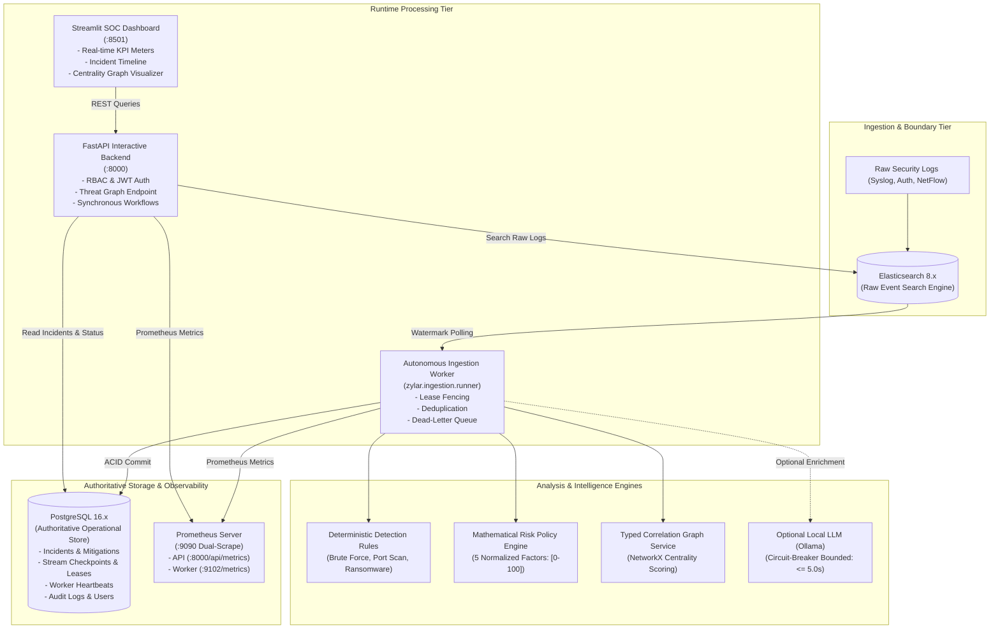
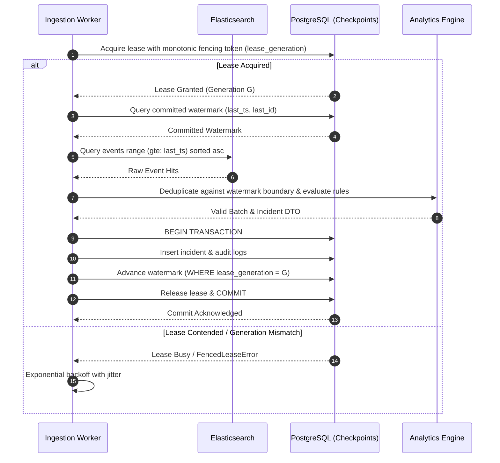
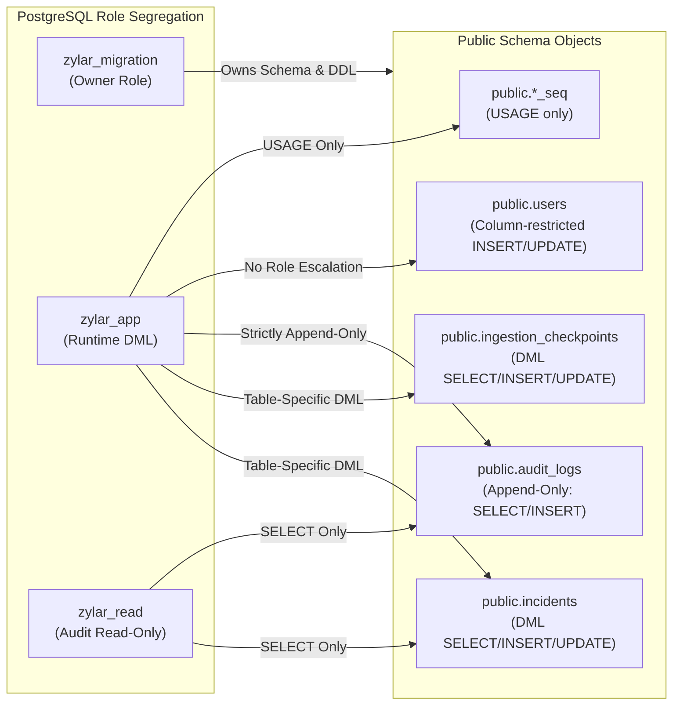

# Zylar System Architecture

## 1. Executive Architecture Overview

Zylar is an enterprise-grade autonomous Security Operations Center (SOC) platform implemented as a **modular monolith**. It combines deterministic attack pattern detection, stateful entity correlation, mathematical risk scoring, and optional local LLM semantic summarization to investigate, score, and mitigate security threats in real time.

---

## 2. Core Subsystems & Contracts

### 2.1 Dual-Storage Persistence Architecture
- **PostgreSQL 16 (System of Record)**: Authoritative store for security incidents, entity correlation history, stream checkpoints, leases, worker instance heartbeats, dead-letter events, user credentials, and audit logs.
- **Elasticsearch 8 (Search Engine)**: Dedicated distributed search engine storing append-only raw security event logs (`security-events-*`).

### 2.2 Process & Network Boundary Separation
- **`api` Container**: Published on loopback `127.0.0.1:8000`. Runs FastAPI with `enable_ingestion_scheduler=false` (zero background polling).
- **`worker` Container**: Internal network only. No published host ports. Executes `python -m zylar.ingestion.runner`. Serves internal metrics on port `9102`.
- **`dashboard` Container**: Published on loopback `127.0.0.1:8501`. Queries API for metrics, incident history, and worker telemetry.
- **`migration` Container**: One-shot container executing `alembic upgrade head` under `zylar_migration` administrative credentials before API or worker start.

### 2.3 Lease Fencing & Ingestion Sequence

---

## 3. Database Least-Privilege Architecture

---

## 4. Observability & Metric Ownership

1. **API Process Metrics**: Served on `:8000/api/metrics` (and `/metrics`), reporting HTTP request latencies and workflow durations.
2. **Worker Process Metrics**: Served on internal port `:9102/metrics`, reporting poll cycle latencies, events received, events deduplicated, dead letters quarantined, and checkpoint advances.
3. **Commit-Boundary Counters**:
   - `zylar_workflow_events_completed_total`: Incremented upon workflow execution completion.
   - `zylar_incidents_persisted_total`: Incremented strictly upon successful PostgreSQL incident commit.
   - `zylar_ingestion_checkpoint_advances_total`: Incremented strictly upon successful checkpoint advancement.

